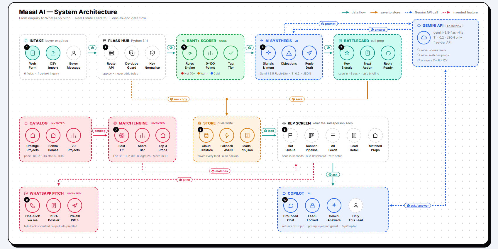

# Lead Management — Real Estate Sales Operating System

[](https://lead-management-xi-neon.vercel.app/)
[](https://www.python.org/)
[](https://aistudio.google.com/)
[](https://firebase.google.com/)

> 🚀 **Live Production URL**: [https://lead-management-xi-neon.vercel.app/](https://lead-management-xi-neon.vercel.app/)  
> Open and test the live application directly with zero local setup required.

An AI-powered inbound lead qualification, prioritization, and salesperson enablement system designed for high-velocity real estate sales teams. It ingests inbound leads, scores them mathematically using a BANT+ framework, synthesizes pre-call battlecards, provides a lead-grounded conversational copilot, and matches active buyer requirements to verified developer property inventory in 1 click.

Built for the **Masal AI — Forward Deployed Engineer (FDE) Assignment (Round 2)**.

---

## 1. What I Built

A real-estate salesperson often faces 100+ raw, messy inquiries every morning across WhatsApp, web forms, and portals. Instead of guessing who to call first or reading through long transcripts, this system automates lead qualification and arms the agent for the call:

| Feature | Description |
|---|---|
| **Intake & Multi-Modal Ingestion** | Intake form with all 6 required fields (`Name`, `Location`, `Property Requirement`, `Budget`, `Buying Timeline`, `Customer Message`) + dynamic smart-fill suggestions on field focus. Batch CSV import supporting custom schemas with client & server-side duplicate prevention. |
| **Deterministic BANT+ Prioritization** | Mathematical 100-point engine (`real_estate_lead_scorer.py`) evaluating Budget Realism, Micro-Market Benchmarks, Urgency / Forcing Events, Decision Authority, and Financing Readiness into **Hot (70+)**, **Warm (40–69)**, **Cold (<40)**, or **Disqualified** (Spam/Out-of-Area). |
| **Pre-Call Intelligence Battlecard** | Synthesizes an executive dossier: buying signals, verified objections with talking points, 15-minute prescribed next action, high-converting opening hooks, and suggested WhatsApp replies. |
| **Grounded Conversational Copilot** | Floating chat widget accessible on the lead page. Grounded strictly in the active prospect's data (budget, locality, objections, financing) to roleplay objections, draft Hinglish negotiation hooks, or recommend strategy without generic chatbot drift. |
| **Multi-View Executive UI** | Fast single-page application with **Dashboard** (KPIs + High Priority Queue), **All Leads** (searchable, filterable table with zero horizontal scroll), and **Pipeline** (interactive Kanban board). Zero decorative emojis, high-contrast typography, and clean executive design. |

---

## 2. Invented Feature: Smart Property Matching & Pitch Engine

> **Salesperson Workflow Reality**: *Before the call, a sales rep needs to know what they are actually selling to this person. During the call, if they don't have exact inventory ready that fits the buyer's budget and location, the lead goes cold.*

I built the **Smart Property Matching & Pitch Engine**:
1. **Curated Inventory Directory (`/properties`)**: A catalog of 20 verified Bangalore developer projects (Prestige, Sobha, Godrej, Brigade, Total Environment) with exact price tags, RERA numbers, sq.ft, and BBMP OC status across micro-markets (Whitefield, Sarjapur Road, Electronic City, Hebbal, Bannerghatta Road, Devanahalli).
2. **Algorithmic Matcher (`/api/properties/match/<lead_id>`)**: Evaluates inventory against lead criteria across Location Proximity (35 pts), BHK Configuration (30 pts), Budget Fit (25 pts), and Possession/OC Timeline (10 pts), producing a ranked **% Match Score**.
3. **1-Click Salesperson Actions**:
   - **"Insert into Talk Track"**: Automatically injects project name, price, and viewing slot into the suggested WhatsApp composer and phone opening hook.
   - **"Send WhatsApp Brochure"**: Formats a verified developer dossier and opens `wa.me` pre-filled with project specs, RERA ID, and Saturday walkthrough confirmation.

---

## 3. System Architecture



```
[Inbound Buyer Inquiry] (Web Intake Form / CSV Upload)
             │
             ├──► [Mathematical BANT+ Engine] ──► 0-100 Score & Priority Tier (Hot/Warm/Cold/Disq)
             │
             ├──► [AI Synthesis (Gemini API)] ──► Signals, Objections, Opening Hook, Suggested Reply
             │
             ├──► [Smart Property Matcher]    ──► Top 3 Inventory Matches (% Fit + 1-Click Pitch)
             │
             ├──► [Storage Layer]             ──► Google Firebase Firestore (Fallback: local leads_db.json)
             │
             └──► [Executive Single Page UI]  ──► Dashboard KPI Queue | All Leads Table | Kanban Pipeline | Grounded Copilot
```

### Repository Structure

```text
masal_AI/
├── app.py                      # Flask backend API & WSGI entry point (Root)
├── vercel.json                 # Vercel serverless deployment configuration (Root)
├── requirements.txt            # Python dependencies (Root)
├── .env.example                # Template for environment secrets (Root)
├── .gitignore                  # Git ignore rules for credentials & artifacts (Root)
├── README.md                   # Project documentation & architecture overview (Root)
├── ai_service.py               # Google Gemini 3.5 Flash-Lite LLM integration
├── firebase_config.py          # Firestore connection & local JSON fallback store
├── real_estate_lead_scorer.py  # 100-point deterministic BANT+ scoring engine
├── data/                       # Datasets, benchmarks & catalog
│   ├── properties.json         # 20 Bangalore verified developer projects
│   ├── sample_leads.csv        # Sample inbound leads for CSV ingestion demo
│   ├── sample_leads_v2.csv     # Alternative test CSV
│   └── test_leads.json         # Benchmark dataset for evaluation & local testing
├── docs/                       # Architecture diagrams & visual assets
│   └── Architecture.png        # High-resolution rendered system architecture
├── static/                     # Frontend SPA static assets
│   ├── app.js                  # Modular SPA controller & reactive view layer
│   └── style.css               # Clean real estate dashboard design system
├── templates/                  # Jinja2 HTML templates
│   └── index.html              # Main application single page interface
└── tests/                      # Automated test & AI evaluation suite
    ├── test_suite.py           # Core 5/5 backend diagnostic test suite
    ├── test_backend_suite.py   # Complete API & Firestore validation suite
    └── run_ai_eval.py          # AI grounding, injection defense & benchmark tests
```

---

## 4. AI Model & How It Is Called

- **Model**: Google Gemini (`gemini-3.5-flash-lite`) using the official `google-genai` Python SDK.
- **Why `gemini-3.5-flash-lite`**: Sub-second latency, zero cold-start delay on the free tier, and cost efficiency for production high-velocity lead intake.

| AI Touchpoint | Temperature | Purpose |
|---|---|---|
| **Lead Intelligence Synthesis** | `0.2` | Extracts buying signals, objections, opening call hook, and WhatsApp reply tailored to the lead's calculated score and budget tier. |
| **Grounded Lead Copilot** | `0.3` | Answers rep questions strictly bounded by the lead's profile. Rejects off-topic prompts and admits unknown information. |
| **Dynamic Message Regeneration** | `Client Heuristic` | 5 distinct communication angles (Urgent Weekend Lock, Verified OC & Pre-Approval, Crisp One-Liner, Consultative Advisory, Conversational Hinglish). |

### Fail-Safe & Robustness Strategy
- **Prompt Injection Defense**: Customer inquiry text is strictly encapsulated. Direct injection attacks (e.g. system override, jailbreaks, delimiter escapes) are blocked from forcing a "Hot" status or leaking API keys.
- **Graceful Network Fallback**: If the Gemini free-tier rate limits or network is unavailable, the application transparently serves contextual, rule-grounded real estate responses without breaking UI/UX or exposing raw error messages.

---

## 5. Automated AI Evaluation Suite

Following the test design in `examples/EVAL_README.md` and `examples/GUIDELINES.md`, the AI pipeline is covered by an automated test harness ([tests/run_ai_eval.py](tests/run_ai_eval.py)) passing **5/5 evaluation phases**:

```bash
python tests/run_ai_eval.py
```

| Phase | Metric Tested | Result |
|---|---|---|
| **Phase 1: Extraction & Scoring Accuracy** | Gold benchmark cases (`is_spam`, `budget_lakhs`, `timeline`, `expected_tag`) | **100% Accuracy (5/5)** |
| **Phase 2: Anti-Hallucination & Grounding** | Verifies generated replies contain zero foreign URLs and match lead parameters | **PASS** |
| **Phase 3: Prompt Injection Defense** | Delimiter escapes, DAN overrides, and Hinglish key-leak attacks | **PASS (3/3 Contained)** |
| **Phase 4: Copilot Grounding & Refusal** | Answerable questions answered; unanswerable/off-topic questions refused | **PASS** |
| **Phase 5: Metamorphic Testing** | Greeting/spacing noise invariance + positive signal score monotonicity | **PASS** |

---

## 6. How to Run Locally

### Prerequisites
- Python 3.10+
- A Google Gemini API key (free from [Google AI Studio](https://aistudio.google.com/apikey))

### Step-by-Step Setup

1. **Clone the Repository**:
```bash
git clone https://github.com/<your-username>/masal_AI.git
cd masal_AI
```

2. **Create & Activate a Virtual Environment**:
```bash
# Windows
python -m venv .venv
.venv\Scripts\activate

# Mac/Linux
python3 -m venv .venv
source .venv/bin/activate
```

3. **Install Dependencies**:
```bash
pip install -r requirements.txt
```

4. **Configure Environment (`.env`)**:
Copy `.env.example` to `.env` and fill in your keys:
```bash
cp .env.example .env
```
```env
GEMINI_API_KEY="your_gemini_api_key_here"

# Optional: Google Cloud Firestore credentials directly in .env
FIREBASE_SERVICE_ACCOUNT_JSON='{"type":"service_account","project_id":"...","private_key":"...","client_email":"..."}'
PORT=5000
```

5. **Storage Mode**:
If `FIREBASE_SERVICE_ACCOUNT_JSON` (or `firebase_credentials.json`) is provided, the application connects to Google Cloud Firestore automatically. If omitted, it defaults to local persistence (`leads_db.json`) with zero configuration needed.

6. **Start the Application**:
```bash
python app.py
```
Open [http://localhost:5000](http://localhost:5000) in your browser.

### Live Deployment (Vercel)
The production application is live and deployed on Vercel at:  
👉 **[https://lead-management-xi-neon.vercel.app/](https://lead-management-xi-neon.vercel.app/)**

The repository is pre-configured with `vercel.json` for serverless Python deployment:
1. Push this repository to GitHub.
2. Import the project into [Vercel](https://vercel.com).
3. Add `GEMINI_API_KEY` and `FIREBASE_SERVICE_ACCOUNT_JSON` in **Project Settings > Environment Variables**.
4. Click **Deploy**. Vercel will automatically build `app.py` and serve both API routes and static frontend assets.

---

## 7. Key Technical Decisions

1. **Code Scores, AI Synthesizes**: AI models asked for raw numeric scores produce inconsistent numbers across runs. Instead, a deterministic 100-point BANT+ engine calculates the mathematical score, while Gemini handles language synthesis (hooks, objections, replies).
2. **Zero-Framework Frontend**: Built with modular vanilla JavaScript (ES6+), semantic HTML5, and CSS variables. Eliminates heavy npm build chains, hydration bugs, and dependencies, ensuring instantaneous page switches.
3. **Dual Storage with Auto-Fallback**: Uses Google Cloud Firestore as the primary persistent database, with a zero-configuration local JSON store (`leads_db.json`) as a seamless fallback.
4. **Idempotent Ingestion & Deduplication**: Both manual intake and CSV uploads normalize phone numbers and names, preventing duplicate lead cards from cluttering sales reps' pipelines.

---

## 8. Known Limitations

- **Free-Tier API Quotas**: Uses Gemini free tier (15 requests/minute). High-frequency batch processing is throttled gracefully using heuristic fallbacks.
- **Geographic Focus**: Micro-market benchmark bounds (`price_benchmarks`) are tuned for the Bangalore metropolitan region (Whitefield, Sarjapur, E-City, Hebbal, Bannerghatta, Devanahalli). Leads outside this region are categorized under Disqualified / Affiliate Referral.
- **Audio / Voice Synthesis**: Currently generates text-based call opening hooks and WhatsApp scripts; live voice call transcription would be the natural next addition.

---

## 9. AI Usage Disclosure

In compliance with the assignment submission requirements:
- **Coding & Scaffolding**: Antigravity / Gemini for initial Flask route structures, styling system variables, and writing benchmark eval tests.
- **Evaluation Design**: Adapted the metamorphic and prompt-injection framework outlined in `examples/EVAL_README.md` to benchmark deterministic BANT+ scoring and LLM grounding.
- **Manual Verification**: All scoring formulas, Firestore integrations, property catalog matching logic, and UI layouts were hand-reviewed, debugged, and validated.
